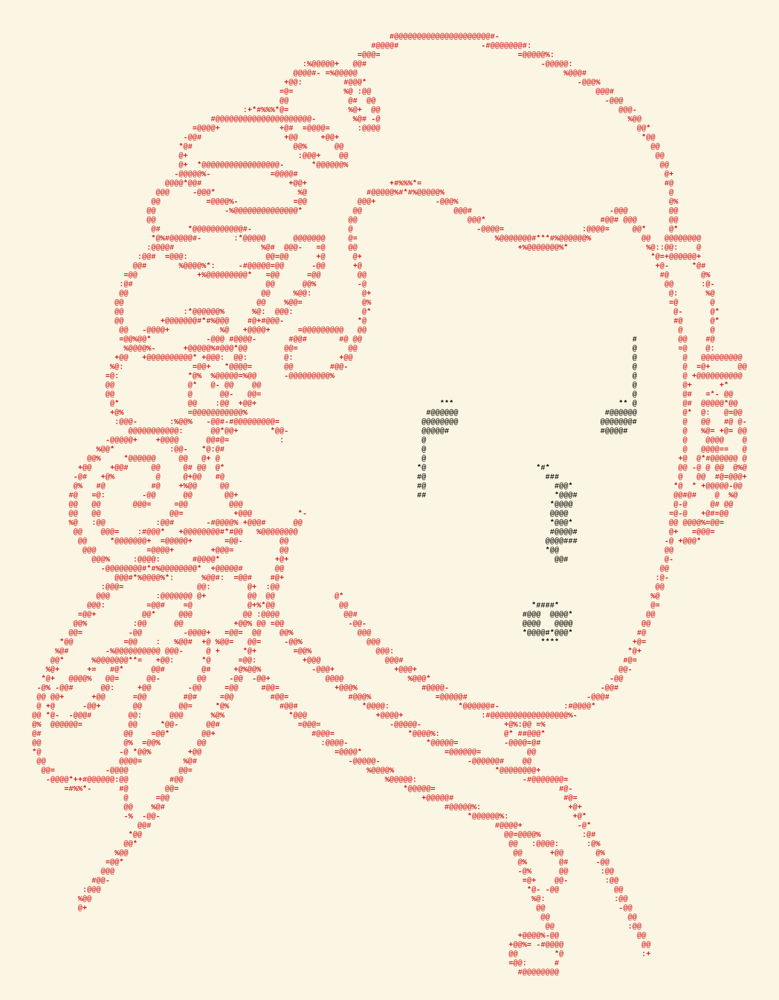

  

<h1 align="center">Mozart</h1>

  An orchestration engine for AI coding agents.

  Plan. Execute. Coordinate.

---

## Overview

Mozart is an extensible orchestration engine designed to
coordinate AI coding agents through structured workflows.

Instead of relying on a single agent to handle an entire
task, Mozart separates planning, execution, and coordination
into independent components.

## Core Concepts

- **Planner** — Decomposes objectives into executable tasks.
- **Orchestrator** — Coordinates workflow execution.
- **Workers** — Execute specialized tasks.
- **Workflows** — Define the structure of execution.
- **Metrics** — Track execution performance.

## Tech Stack

- TypeScript
- Node.js
- OpenAI SDK

## Status

Under active development.

